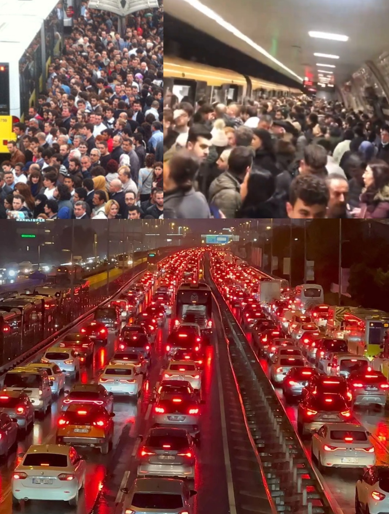

08.11.2026

DevCom Analiz: Modern Cendere ve Zaman

Dünyaya geliyoruz ve zaman sayacı geriye doğru saymaya başlıyor. Önümüzde sınırsız seçenek var gibi görünüyor. Ancak birilerinin biz daha doğmadan bizim için yaptığı bir kurgu var.

Elimiz ayağımız tutmaya başlayıp zihinsel aktivitemiz devreye girdiği anda formatlanmaya başlıyoruz. Her yerde farklı anlatılan ve "nesnel" olarak "doğru” olduğu söylenen "bilimsel” veriler beynimize basılıyor. Kimiz, nasıl davranmalıyız, nasıl düşünmeliyiz, ileride seçeceğimiz yollar neler hepsi belli. Hayatımızın ilk kısmı bunları ezberleyerek geçiyor.

Sonrasında sunulan yollardan birine giriyoruz ve ilk 20 yıl uğruna çalıştığımız hayat başlıyor. Sabah erken kalkıyoruz, trafiğe giriyoruz, 8 saat belirli bir şeyi yapıyoruz, geri trafiğe çıkıyoruz ve günün yorgunluğuyla eve gelip ertesi güne hazırlanıp devam ediyoruz. Bu döngüde kaldığımız için ödül olarak ekranda bazı sayılar görüyoruz. Hafta sonları da uzayan saçımızı kestirmek için berbere, yıprandığı için araba tamircisine, hastalandığımız için hastaneye, sayıları eksiltip “mutlu" şekilde döngüde kalmak için de alışveriş merkezine gidiyoruz. Sonra da yine hafta içi oluyor.

Döngü bu şekilde ömür yeterse yıllarca her an birileri eksilirken yenilerinin katıldığı şekilde devam ediyor. Bir noktada biz de eksilenler tarafına geçiyoruz ve bizim için kurgulanan döngü bitiyor. Son noktada da döngüde koşturmak için bir araç, barınmak için beton kutucuk veya kutucuklar, birkaç avuç kuru toprak ve yine ekrandaki bazı sayılar kalıyor. Peki buna değiyor mu?

1000 yıl öncesine gidelim. Bir efendi, kölesinin kendisine iyi hizmet edebilmesi ve sağlıklı kalması için ona sağlam gıdalar veriyordu. Randımanı düşmesin diye uyuduğundan emin oluyordu. Yanında gezerken itibarını düşürmesin diye ona kıyafet temin ediyordu. Daha şevkle çalışsın ve kendisine ihaneti düşünmesin diye onu evlendirip çocuğunu işe alıyordu. Yani 1000 yıl önceki kölenin barınma, beslenme, evlenme, giyinme, dinlenme gibi hiçbir sorun aklının ucundan bile geçmiyordu. Halbuki güncel “özgür" çalışanlar bu kalemlerin tamamı için ölümüne zorluyor ve en basitinden barınmak için bir evi almayı hayal bile edemiyorlar (Her ay 100 bin lirayı kuruşuna dokunmadan kenara koyup bu parayı enflasyona yedirmeyecek şekilde değerlendiren birinin 10 milyonluk bir apartman dairesini alması 10.000.000 / 100.000 =100 ay = 8.3 yıl). Yani koca bir insanlık olarak daha doğduğumuz anda bize kurgulanan tuzağın içinde ömrümüzü yitirmeyi bekliyor ve özgür olduğumuzu sanıyoruz. Peki buradan ne çıkarmalıyız?

Buradan çıkarmamız gereken ders, hali hazırda hayatımızın çok büyük bir kısmı için karar hakkımızın olmadığı ve geri kalan kısmı için de çok az zamanımızın olduğudur. Yani ya bu cenderede dönüp sonu belli olan yolu gidip mutlu olmaya ikna olup beton kutucuğumuzda ölümü bekleyeceğiz ya da hamle hakkımız olan zamanlarda zorlayıp cendereden çıkmanın yollarını arayacağız. Zihnimiz keskin, yolumuz açık olsun.
